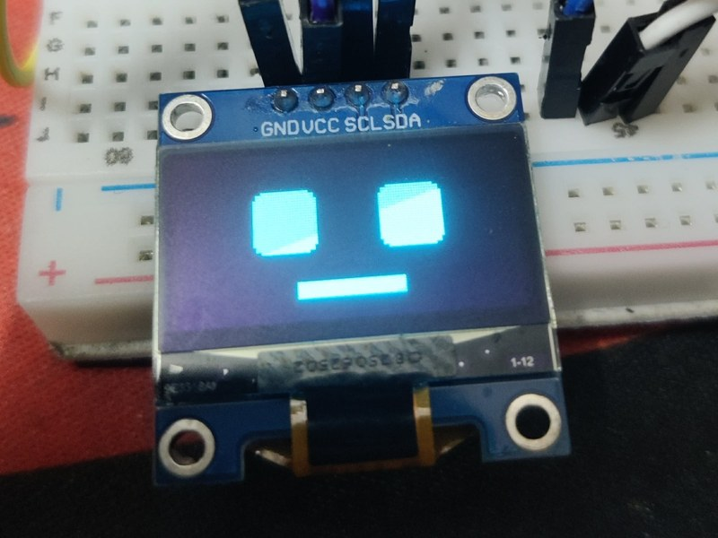
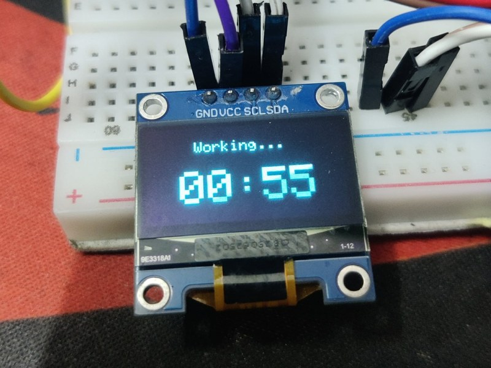
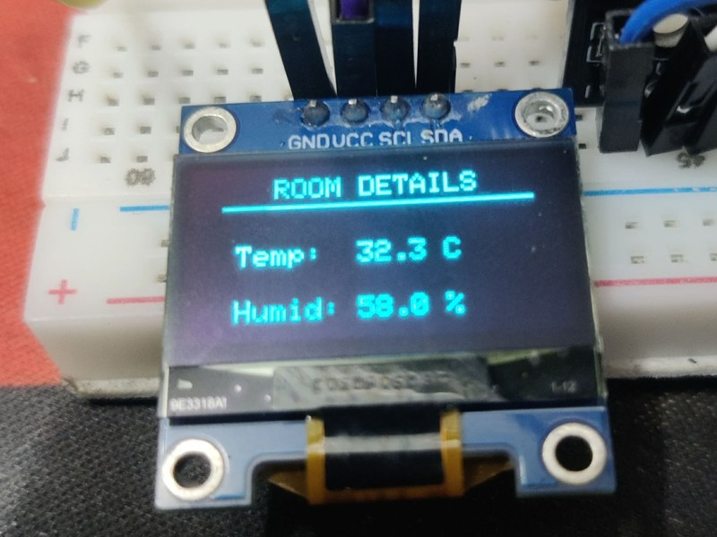
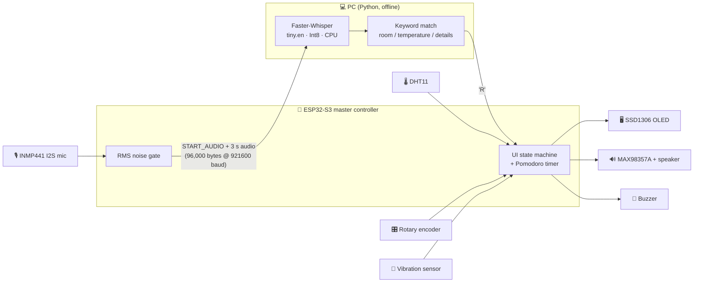
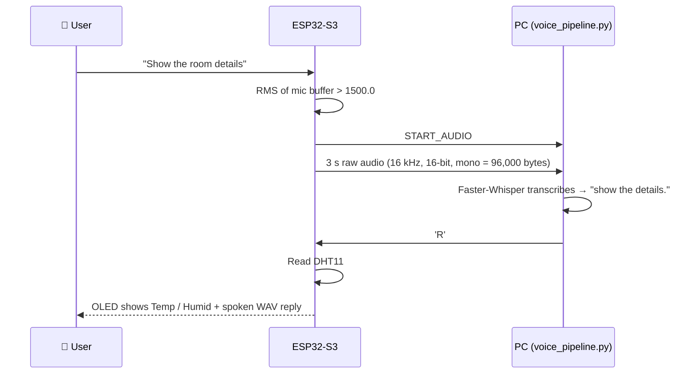
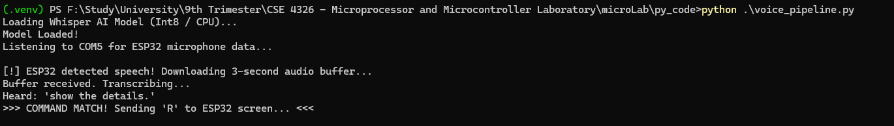
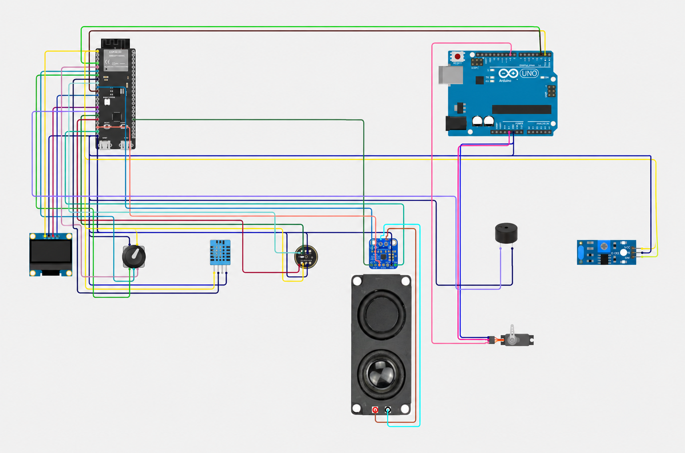
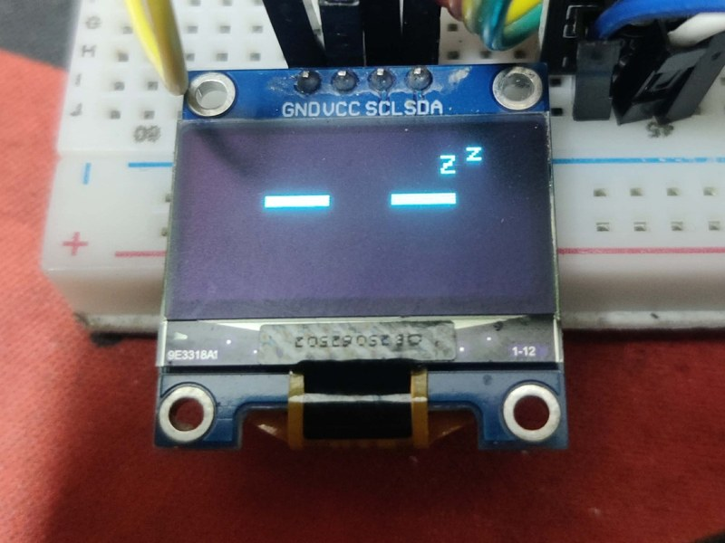
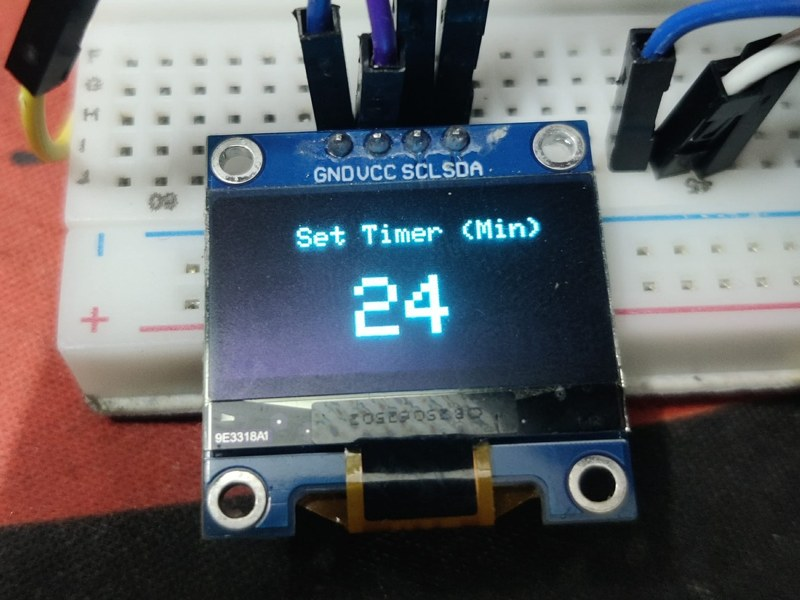
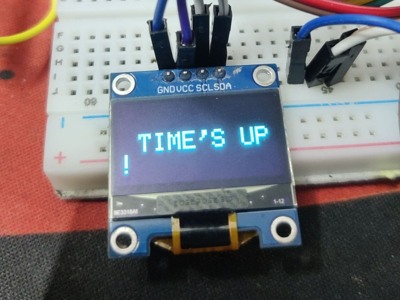

# 🐝 DeskBEE: Voice AI & Productivity Companion

A desk companion built on an **ESP32-S3**. It combines a **Pomodoro timer** with a **voice-activated room monitor**: ask *"show the room details"* and DeskBEE reads the temperature and humidity, shows them on its OLED face, and answers through a speaker. Speech recognition runs **offline** on your own PC with [Faster-Whisper](https://github.com/SYSTRAN/faster-whisper), so no audio is sent to the cloud.

> CSE 4326 Microprocessor and Microcontroller Laboratory · United International University

**[▶ Demo video](https://drive.google.com/drive/folders/1tZC6TZ2J6uB5XZFCrDfc70PA-nQj4Uqx?usp=sharing)** · **[📄 Project report (PDF)](docs/DeskBEE_Report.pdf)**

<p align="center">
  
  
  
</p>

---

## ✨ Features

| | Feature | How it works |
|---|---|---|
| ⏱️ | **Pomodoro timer** | Turn the knob to set 1–99 min (default 25), press to start. Beeps at 1:00 and 0:30 remaining, then shows **TIME'S UP!** with the buzzer. |
| 🙂 | **Expressive OLED face** | Awake face when idle, sleeping face after a period of no interaction. |
| 📳 | **Tap to wake** | A vibration sensor wakes DeskBEE: just tap the desk. Turning or pressing the knob also wakes it. |
| 🎙️ | **Voice room query** | Say *"room"*, *"temperature"* or *"details"*. DeskBEE shows temperature and humidity for 5 s and plays a spoken reply. |
| 🔒 | **Offline speech recognition** | Faster-Whisper `tiny.en` (Int8, CPU) runs locally on the PC. |

---

## 🧠 How it works

DeskBEE splits the work between two devices. The **ESP32-S3** handles everything real-time (display, knob, sensors, buzzer, I2S audio in and out). The **PC** does the heavy speech recognition and replies with a single command byte.



### Voice query, step by step



<p align="center">
  
  <br><em>The PC side of a real query: speech detected, buffer received, "show the details." matched, <code>'R'</code> sent.</em>
</p>

### Serial protocol (921600 baud)

| Message | Direction | Meaning |
|---|---|---|
| `START_AUDIO` | ESP32 → PC | Noise gate exceeded; an audio block follows |
| *audio block* | ESP32 → PC | Exactly 96,000 bytes = 3 s of 16 kHz 16-bit mono audio |
| `R` | PC → ESP32 | Command recognised: read the DHT11, show it and play the reply |
| `Z` | PC → ESP32 | Wake DeskBEE (same as a tap) |
| `1` / `0` | PC → ESP32 | Set / clear the posture-flag signal on GPIO 18 *(experimental, see below)* |

To keep the buzzer and alerts clean, the mic stream is **paused** while DeskBEE is asleep, during the last minute of a countdown, on the Time's Up screen, and while room details are showing.

---

## 🔌 Hardware

| Component | Role | ESP32-S3 pins |
|---|---|---|
| ESP32-S3 dev board | Master controller | — |
| SSD1306 OLED 128×64 (I2C, `0x3C`) | Face and UI | SDA **8**, SCL **9** |
| Rotary encoder with push-button (HW-040) | Set / start / cancel timer | CLK **5**, DT **6**, SW **7** |
| SW-18010P vibration sensor module | Tap to wake (active-low) | **4** |
| DHT11 | Temperature and humidity | **15** |
| INMP441 I2S microphone | Voice capture | SCK **16**, WS **11**, SD **12** |
| MAX98357A I2S amplifier + speaker | Spoken reply | BCLK **17**, LRCK **21**, DIN **14** |
| Active buzzer | Timer alerts | **10** |
| *Arduino Uno + SG90 servo (experimental)* | *Posture flag* | *signal on **18*** |

<p align="center">
  
</p>

---

## 🚀 Getting started

### 1. Flash the ESP32-S3

1. Install the **ESP32** board package in the Arduino IDE and select your ESP32-S3 board.
2. Install these libraries from the Library Manager:
   - `Adafruit GFX Library`
   - `Adafruit SSD1306`
   - `ESP32Encoder`
   - `DHT sensor library` (Adafruit)
   - `ESP32Servo` (the sketch includes it, so it must be installed even though the servo is experimental)
3. Open `sketch_sep26a.ino`. If the IDE asks to move it into a folder of the same name, accept, and make sure **`room_details_audio.h` sits in that same folder**.
4. Upload. The OLED should show the awake face.

> The firmware uses the ESP32 legacy I2S driver (`driver/i2s.h`): port 0 for the mic, port 1 for the speaker.

### 2. Run the voice pipeline on your PC

```bash
python -m venv .venv
# Windows: .venv\Scripts\activate    macOS/Linux: source .venv/bin/activate
pip install faster-whisper pyserial numpy
```

Open `voice_pipeline.py` and set `SERIAL_PORT` to your board's port (`"COM5"` on Windows, something like `"/dev/ttyACM0"` on Linux). Then run:

```bash
python voice_pipeline.py
```

The first run downloads the `tiny.en` model. You should see:

```
Loading Whisper AI Model (Int8 / CPU)...
Model Loaded!
Listening to COM5 for ESP32 microphone data...
```

> ⚠️ **Close the Arduino Serial Monitor first.** Only one program can hold the COM port, and the Python script needs it.

### 3. Use it

- **Timer:** turn the knob to choose the minutes, press to start, press again to cancel.
- **Wake:** tap the desk (or touch the knob).
- **Voice:** while DeskBEE is awake, say *"show the room details"*.

---

## ⚙️ Tuning

| Setting | File | Default | What it does |
|---|---|---|---|
| `RMS_NOISE_GATE` | `.ino` | `1500.0` | Raise it if fans or background noise trigger recordings; lower it if your voice doesn't. |
| `IDLE_TIMEOUT` | `.ino` | `900000` ms (15 min) | Time before the sleeping face. We used `10000` (10 s) for demos. |
| `SERIAL_PORT` | `.py` | `"COM5"` | Your ESP32's serial port. |
| keyword list | `.py` | room, temperature, details, aperture, better, boom | The last three are common Whisper mishearings of the command, added as a fallback. |
| `initial_prompt` | `.py` | "Show the room temperature details." | Steers the tiny model towards the expected words. |

**Changing the spoken reply:** `room_details_audio.h` holds a WAV file as a C byte array (`converted_wav`, `converted_wav_len`). To use your own reply, convert a 16 kHz, 16-bit, mono WAV into a C array with the same two names and replace the file.

---

## 📁 Repository structure

```
├── sketch_sep26a.ino       # ESP32-S3 firmware: UI, Pomodoro, sensors, I2S audio, serial protocol
├── room_details_audio.h    # Spoken reply as a C byte array, played over I2S
├── voice_pipeline.py       # PC side: receives audio, runs Faster-Whisper, sends 'R'
└── docs/
    ├── DeskBEE_Report.pdf  # Full IEEE-style project report
    └── images/             # Photos and diagrams used in this README
```

---

## 📸 Gallery

| Awake | Sleeping | Set timer |
|---|---|---|
|  |  |  |
| **Counting down** | **Time's up** | **Room details** |
|  |  |  |

---

## 🧪 Experimental: posture warning

We also attempted a posture-warning feature. An **ESP32-CAM** streamed video to the PC, **MediaPipe** compared the user's head-to-shoulder ratio against a calibrated baseline, and after 5 s of bad posture the PC would signal the ESP32 (`'1'` → GPIO 18), which signalled an **Arduino Uno** to raise a servo flag.

The detection worked when tested on its own, but it **was not integrated into the final build**:
- Servo PWM on the ESP32 conflicted with the I2S audio timing, so the servo was moved to an Uno.
- The ESP32 uses 3.3 V logic and the Uno uses 5 V, which needs level shifting.
- The PC had to handle the serial audio stream and the MJPEG video stream at the same time, which caused buffer overruns.

The posture code is not part of this repository. The report has the full failure analysis.

---

## 🛣️ Limitations and future work

- Needs the PC running for voice features (the timer works without it).
- The trigger is a volume gate, so loud non-speech sounds can start a recording.
- Built on a breadboard: the only failed voice queries in our testing came from loose jumper wires.
- **Planned:** camera-based presence detection, so DeskBEE sleeps after 5 minutes away from the desk; a soldered board; on-device keyword spotting.

---

## 👥 Team

| Name |
|---|
| Rumman Karim |
| Anika Islam |
| Abdul Gofran Emon |
| Sifat Zaman |
| Arup Saha |

Course instructor: **Md. Shafqat Talukder**, Lecturer, Dept. of CSE, United International University.

## 🙏 Acknowledgements

- [Faster-Whisper](https://github.com/SYSTRAN/faster-whisper) by SYSTRAN, and OpenAI's [Whisper](https://github.com/openai/whisper)
- [Adafruit GFX / SSD1306](https://github.com/adafruit/Adafruit_SSD1306) and the [DHT sensor library](https://github.com/adafruit/DHT-sensor-library)
- [ESP32Encoder](https://github.com/madhephaestus/ESP32Encoder)
